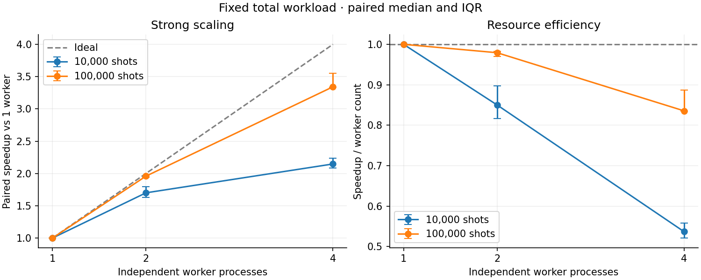
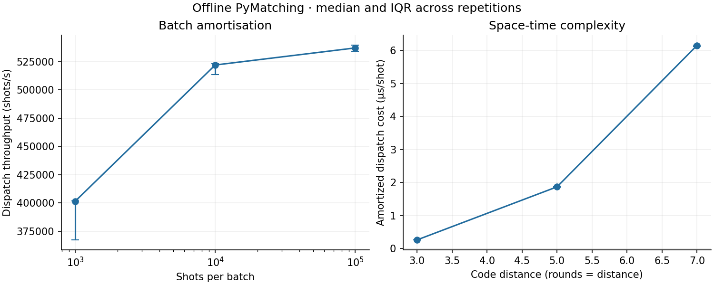

# QEC-HPC-Scaling

**Benchmarking classical quantum error correction decoding at scale.**

QEC-HPC-Scaling measures how offline decoding cost changes with batch size,
surface-code space-time complexity and independent CPU worker processes.
Stim generates noisy quantum-memory experiments and PyMatching decodes them.
Riverlane's QStone generator supplies the basis for an adapted SLURM execution
path. **Measured results are local Windows CPU results; HPC has not been run.**

The contribution is a controlled scaling experiment with explicit timing
boundaries and verified parallel outputs, rather than a new simulator, decoder,
or scheduler. This is an independent project, not a Riverlane product.

## Main finding

At distance 5, five rounds and 100,000 shots, four warmed worker processes
achieved **3.34× median paired speedup** (IQR 3.34–3.55), about **84% efficiency**.
At 10,000 shots, four workers achieved **2.15×** (IQR 2.08–2.23), about **54%**.
Dispatch and synchronization costs limit the smaller batch more strongly.

This is a **warmed-pool** result. Median pool creation and warmup took roughly
2.1 s with one worker and 8.5 s with four, whereas dispatch for the 100,000-shot
batch took about 186 ms and 55 ms respectively. Creating a new pool for a single
batch is consequently a poor optimisation on this machine. A real service should
measure persistent-pool execution and amortise setup over many batches.



## Why this problem matters

Quantum error correction distributes a logical qubit across physical qubits and
repeatedly measures checks that reveal error information without directly
reading the protected logical state. A classical decoder interprets those check
patterns, or detector events, and predicts a correction to the logical state.

Decoding must keep up with incoming data; feedback can also impose latency
deadlines. These are different requirements. This project measures offline batch
throughput and amortized cost. It does **not** demonstrate real-time feedback
latency or performance of Riverlane's FPGA/Deltaflow decoders.

## Why these tools

- **Stim 1.16.0:** established stabiliser-circuit simulation, detector sampling
  and detector error models; no quantum hardware or account needed.
- **PyMatching 2.4.0:** compiled minimum-weight perfect matching decoder with a
  batch API. There is no thread-count argument in that API: parallelism here
  splits independent shots among processes, each owning a decoder.
- **QStone:** Riverlane's HPC/quantum integration benchmark already supplies
  job packaging, scheduler templates and stage profiling. Its current built-in
  PyMatching workload fixes distance/rounds/noise and its POST stage mixes
  decoding with other work. It cannot supply the decoder-only controlled sweep
  directly. This project reuses its SLURM generator, retaining the original
  output and explicitly adapting the execution body for this offline workload.
- **Deltakit:** inspected, but not required or used in these measurements.
  Its circuit/noise/analysis workflows also use Stim and expose local
  PyMatching decoding. Richer noise models would be a sensible later extension.

The audit is pinned to current inspected commits in [the technical plan](docs/PLAN.md).
QStone is not on the measured hot path. No QStone decoding benchmark results
are presented as this project's measurements.

## Reproduce locally

Python 3.10–3.12 is recommended. Start from the repository root:

```bash
python -m venv .venv
# Linux/macOS:
source .venv/bin/activate
# Windows PowerShell instead:
# .venv\Scripts\Activate.ps1
python -m pip install -r requirements.txt
python -m unittest discover -s tests -v
python run_scaling.py --config configs/smoke.json --output scratch/smoke
python run_scaling.py --config configs/local.json --output results --label local-new
```

Analyse the **new run directory printed by the runner**, independently of the
checked-in run:

```bash
python analyse_results.py results/YOUR_RUN_ID --output figures/new-run
```

To regenerate the included figures:

```bash
python analyse_results.py results/20261101T213409Z-71329104 --output figures
```

The measured matrix used 3.705 million simulated shots in total and about
4 minutes on this host. Machine load changes runtime. Smoke takes much less.
Every successful case is flushed immediately to JSONL; interrupted runs retain
completed cases. Check repetition counts before interpreting partial data.

## Experiments and initial results

All experiments use rotated surface-code X-memory circuits, noise probability
`p=0.005` **only after Clifford gates**, default uncorrelated MWPM and unpacked
detector arrays. This is not a full hardware noise model. Five fresh seeds and
fresh pools per case; case order is shuffled within each repetition.

| Experiment | Hypothesis / independent variable | Dependent variables | Controls |
|---|---|---|---|
| Batch size | More shots amortise dispatch overhead; 1k/10k/100k shots | Throughput, amortized time | d=5, rounds=5, 1 worker, fixed p |
| Complexity | Larger space-time graphs cost more; d=3/5/7, rounds=d | Cost/shot, detector count, failures | 100k shots, 1 worker, fixed p |
| Strong scaling | More workers help larger batches more; 1/2/4 processes | Paired speedup, efficiency, dispatch/kernel times | Same total shots, d=5, rounds=5, fixed p, identical input hashes |

Each row below is a median [first quartile, third quartile], **not** a
confidence interval. Five timings do not justify significance claims from small
differences. Speedups use seed-paired timing ratios, not ratios of medians.

| Shots | 1-worker throughput (shots/s), batch-size experiment |
|---:|---:|
| 1,000 | 401,590 [367,309, 401,897] |
| 10,000 | 522,101 [513,619, 523,092] |
| 100,000 | 537,204 [534,266, 539,789] |

Most throughput gain appears between 1k and 10k. The smaller subsequent gain
suggests diminishing dispatch amortisation; more isolated measurements would
be needed to resolve small differences reliably.

| Distance / rounds | Detectors | Median dispatch cost (µs/shot) | Logical failure probability, 95% Wilson interval |
|---:|---:|---:|---:|
| 3 / 3 | 24 | 0.263 | 0.005946 [0.005737, 0.006163] |
| 5 / 5 | 120 | 1.871 | 0.004852 [0.004663, 0.005048] |
| 7 / 7 | 336 | 6.157 | 0.002894 [0.002749, 0.003047] |

The d=7 workload costs about 23× as much per shot as d=3 in this experiment.
Distance and round count both increase, so this does not isolate spatial
distance or establish an asymptotic exponent. Logical failures are a secondary
sanity check, not a threshold study or a physical-error-rate sweep.



| Fixed shots | Workers | Median throughput (shots/s) | Paired speedup [IQR] | Median efficiency |
|---:|---:|---:|---:|---:|
| 10,000 | 1 | 517,371 | 1.00 | 100% |
| 10,000 | 2 | 893,823 | 1.70 [1.63, 1.79] | 85% |
| 10,000 | 4 | 1,110,864 | 2.15 [2.08, 2.23] | 54% |
| 100,000 | 1 | 538,776 | 1.00 | 100% |
| 100,000 | 2 | 1,050,846 | 1.96 [1.94, 1.96] | 98% |
| 100,000 | 4 | 1,820,376 | 3.34 [3.34, 3.55] | 84% |

Input and prediction hashes match across every worker-count comparison.
One two-worker 100k trial achieved only 1.33× speedup; it remains in the raw data.
Quartiles should not be read as the full observed range.

## Method and limitations

Dispatch timings start after input generation, decoder construction and worker
warmup; they include synchronization and returned predictions. Each worker
also times its actual batch decode. Worker RSS is a snapshot, **not peak
memory**. CPU times were too coarsely quantised for short Windows trials, so
CPU utilisation is not interpreted. `µs/shot` is amortized cost, **not a
single-shot latency measurement**. See the exact [measurement contract](docs/METHODOLOGY.md).

Initial host: Intel Core i5-10400F, 6 physical cores / 12 logical CPUs,
Windows build 26200, Python 3.10.6. No CPU pinning or exclusive allocation;
background load, SMT, clocks and filesystem caching can affect results.
Metadata records hardware, affinity, RAM, versions, seeds, config hash,
measurement-time code hashes and any SLURM variables. Analysis/reporting can
evolve after measurement; the benchmark source hashes identify the timed code.
The initial run predates git initialisation, so its revision is null rather
than an invented commit.

Evidence: [raw JSONL](results/20261101T213409Z-71329104/measurements.jsonl),
[metadata](results/20261101T213409Z-71329104/metadata.json),
[summary CSV](figures/summary.csv), [paired ratios](figures/paired_speedups.csv).
Different machines/software are kept in separate analysis cohorts. Reused seeded
datasets across experiment families or worker counts must not be pooled to
inflate logical-error sample sizes.

## SLURM extension

[HPC instructions](docs/HPC.md) describe the QStone-generated pathway, exact
local adaptations, Stanage environment setup, CPU allocation, local scratch and
aggregation. The example is generated and inspected locally; it has **not**
been submitted to SLURM. No SSH, cluster credentials or QPU resources are needed
for the local project.

Useful next experiments: persistent pools over many batches; fixed-rounds
distance sweep; larger workloads once startup is amortised; same-node repeated
SLURM runs with core binding; only then NUMA and multi-node campaign execution.
Do not launch a million shots or eight workers simply to enlarge the matrix.

## Repository map

| Path | Purpose |
|---|---|
| `qec_bench.py` | Seeded workload, process workers, measurement boundaries |
| `run_scaling.py`, `configs/` | Repeated, randomized config-driven execution |
| `analyse_results.py` | Validated aggregation, CSVs and plots |
| `results/`, `figures/` | Actual initial local measurements and analysis |
| `scripts/generate_slurm.py`, `slurm/` | QStone generator reuse and example output |
| `tests/` | Decoder correctness, splitting and analysis safeguards |
| `docs/` | Audit, methodology, HPC guide and interview explanation |

QStone contribution candidates are documented in [UPSTREAM.md](docs/UPSTREAM.md).
No issue, PR or message has been submitted upstream.
