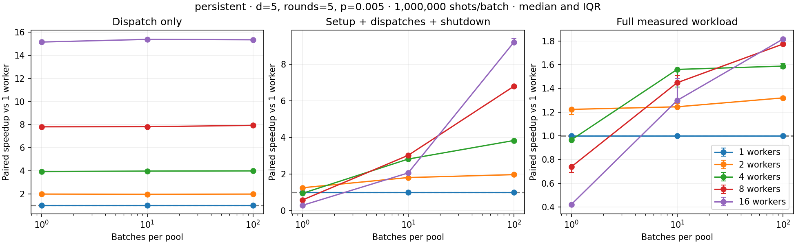

# QEC HPC Scaling

Quantum error correction needs a classical decoder to interpret error measurements. I wanted to see how much faster I could decode a batch by splitting it between CPU workers, and whether starting all those workers was worth it.

I used Stim to simulate surface-code quantum memories and PyMatching to decode them. Each worker has its own decoder and handles part of the same batch. I kept the total amount of work fixed when changing the worker count, so adding CPUs meant sharing the work rather than doing more of it.

I started on my Windows desktop, where four workers gave a 3.34× median paired speedup for 100,000 shots. I then moved the experiments to the University of Sheffield's Stanage HPC cluster and used Slurm to run them with 1, 2, 4, 8 and 16 workers. With one million shots, 16 workers reached **10.07 million shots per second**, a **15.16× median paired speedup and 94.7% parallel efficiency**.

That looked good, but the timing started after the workers were ready. Starting and warming 16 workers took about 6.6 seconds, while decoding the million-shot batch took about 0.1 seconds. Creating a fresh group of workers for just one batch would cost more time than the faster decoding saved.

So I added a persistent pool: start the workers once, give them several batches, then close them. I tested 1, 10 and 100 batches per pool, using fresh simulated data for every batch. The follow-up covered **150 pool sessions and 5,550 batch decodes**.

For one million shots per batch, 16 workers were slower overall than one worker when processing a single batch. Reusing them for 100 batches changed that. The median paired speedup was **9.20× when counting startup, dispatches and shutdown**, and **1.82× for the full measured workload**, including input generation, hashing, file writes and validation. That is about **45% less time for the full workload**. Faster decoding helped, but the rest of the program still took time.

More workers were not always better. For 100 batches of 100,000 shots, eight workers gave a 1.74× full-workload speedup, compared with 1.43× for 16. The useful worker count depended on how much work there was to share.

I also compared code distances 3, 5 and 7 while keeping the number of rounds fixed at five. Larger codes took more time to decode: one-worker median throughput fell from 3.16 million shots per second at distance 3 to 0.286 million at distance 7.

Each case had five seeded repetitions, with the case order shuffled. The analysis checked that the inputs, predictions and failure counts matched across worker counts. All 16 automated tests passed locally and on Stanage, including checks for worker reuse, fresh batches, uneven splitting and incomplete results.

These are offline CPU experiments with a limited simulated noise model. They do not measure real-time quantum hardware or individual-shot latency. The two HPC campaigns ran in separate allocations, and each uses its own one-worker baseline. The figures show medians and quartiles; the results do not establish performance across the whole cluster.

The [scaling results](figures/stanage-12198700/summary.csv), [persistent-pool results](figures/persistent-12198916/speedup_summary.csv) and raw data for the [scaling run](results/20261118T180740Z-0775c4d9) and [persistent run](results/persistent/20261118T190200Z-ceaad759) are included. The [HPC guide](docs/HPC.md), [persistent-pool notes](docs/PERSISTENT.md) and [measurement contract](docs/METHODOLOGY.md) explain the experiments and how to run them.

[Stim](https://github.com/quantumlib/Stim) · [PyMatching](https://github.com/oscarhiggott/PyMatching) · [QStone attribution](THIRD_PARTY.md) · [MIT licence](LICENSE)
